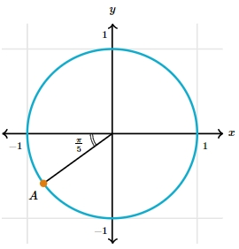
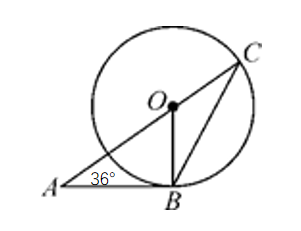

# AVP0002 — Single visual target

MathVerse:527 / MathVerse:4 · same type · Numeric representation and conversion

## Shared or similar visual information

Numerical notations π/5 and 36°

## Evidence locations

- Left image: The angle label π/5 below and to the left of the origin, between the negative x-axis and the radius.
- Right image: The angle label 36° at A in the lower-left part of the image.

## Mathematical meanings

Left image: The local angle at the circle's center measures π/5 radians. Right image: The local angle at A measures 36 degrees.

## Same mathematical meanings

yes

## Rationales

π/5 radians equals 36 degrees; both numerical labels specify the size of an angle.

Only the selected target is annotated. AI visual-review draft; not independently double-annotated by humans.
