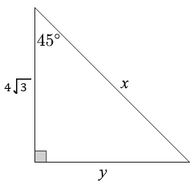

# AVP0003 — Single visual target

MathVerse:354 / MathVerse:375 · same type · Numeric representation and conversion

## Shared or similar visual information

Two 45° labels

## Evidence locations

- Left image: The label 45° at D, the right endpoint of the large triangle's base.
- Right image: The label 45° beside the upper-left angle of the single right triangle.

## Mathematical meanings

Left image: The marked interior angle at D measures 45 degrees. Right image: The marked upper-left interior angle measures 45 degrees.

## Same mathematical meanings

yes

## Rationales

Both 45° labels give an interior angle measure, with matching numerical values and local roles.

Only the selected target is annotated. AI visual-review draft; not independently double-annotated by humans.
