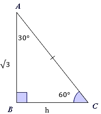
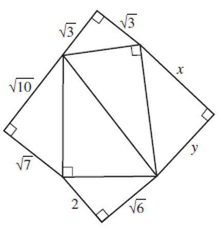

# AVP0004 — Single visual target

MathVerse:369 / MathVerse:375 · same type · Numeric representation and conversion

## Shared or similar visual information

The radical length labels √3 and 4√3.

## Evidence locations

- Left image: √3 beside vertical leg AB.
- Right image: 4√3 beside the vertical leg.

## Mathematical meanings

Left image: √3 is the length of leg AB. Right image: 4√3 is the length of the vertical leg.

## Same mathematical meanings

no

## Rationales

Both labels give a right-triangle leg length, and the right value is four times the left value.

Only the selected target is annotated. AI visual-review draft; not independently double-annotated by humans.
