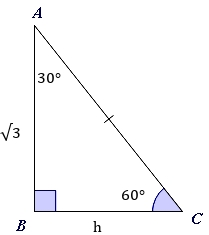
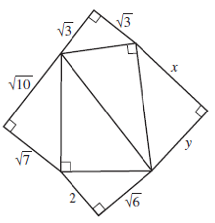

# AVP0004 — Single visual target

MathVerse:369 / MathVerse:755 · same type · Numeric representation and conversion

## Shared or similar visual information

The radical value √3 in both images.

## Evidence locations

- Left image: The label √3 beside side AB on the left of the triangle.
- Right image: The label √3 beside the left sloping side of the small right triangle at the top of the composite figure.

## Mathematical meanings

Left image: The corresponding segment has length √3. Right image: The corresponding segment has length √3.

## Same mathematical meanings

yes

## Rationales

The complete radical and its role as a segment length match; the segments need not be the identical geometric object.

Only the selected target is annotated. AI visual-review draft; not independently double-annotated by humans.
