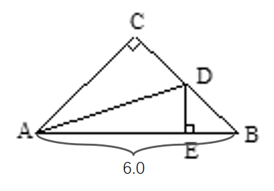
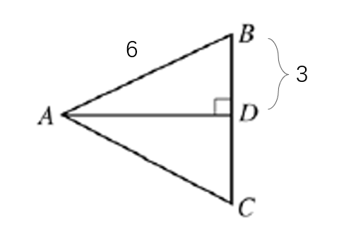

# AVP0005 — Single visual target

MathVerse:9 / MathVerse:758 · same type · Numeric representation and conversion

## Shared or similar visual information

Numerical notations 6.0 and 6

## Evidence locations

- Left image: The label 6.0 below the bracket spanning A and B at the bottom of the triangle.
- Right image: The label 6 beside the upper sloping side AB in the right image.

## Mathematical meanings

Left image: Segment AB has a length value of 6. Right image: Segment AB has a length value of 6.

## Same mathematical meanings

yes

## Rationales

6.0 and 6 are exactly equal, and both labels give the length of the marked segment.

Only the selected target is annotated. AI visual-review draft; not independently double-annotated by humans.
