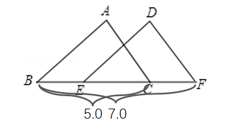
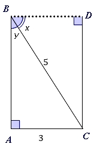

# AVP0006 — Single visual target

MathVerse:8 / MathVerse:349 · same type · Numeric representation and conversion

## Shared or similar visual information

Numerical notations 5.0 and 5

## Evidence locations

- Left image: The label 5.0 below the left length bracket at the bottom of the image.
- Right image: The label 5 beside diagonal BC inside the rectangular configuration.

## Mathematical meanings

Left image: The horizontal segment indicated by the lower bracket has a length value of 5. Right image: Diagonal BC has a length value of 5.

## Same mathematical meanings

yes

## Rationales

Removing the trailing zero gives the value 5; both labels specify a segment length.

Only the selected target is annotated. AI visual-review draft; not independently double-annotated by humans.
