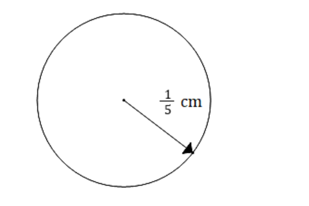
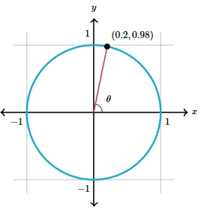

# AVP0007 — Single visual target

MathVerse:398 / MathVerse:556 · same type · Numeric representation and conversion

## Shared or similar visual information

Fractional and decimal notations for one real number: 1/5 and 0.2.

## Evidence locations

- Left image: The numerical part 1/5 in the label 1/5 cm beside the radius arrow inside the circle.
- Right image: The first component, 0.2, of the black point's coordinate label (0.2,0.98) on the circle.

## Mathematical meanings

Left image: The radius length has numerical value 1/5, in cm. Right image: The marked point has x-coordinate 0.2.

## Same mathematical meanings

no

## Rationales

1/5=0.2, but one value labels a radius length and the other an x-coordinate; their local mathematical roles differ.

Only the selected target is annotated. AI visual-review draft; not independently double-annotated by humans.
