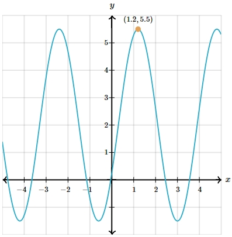

# AVP0008 — Single visual target

MathVerse:531 / MathVerse:535 · same type · Numeric representation and conversion

## Shared or similar visual information

The decimal 1.2 in both images.

## Evidence locations

- Left image: The first component, 1.2, of the orange peak point's coordinate label (1.2,5.5).
- Right image: The second component, 1.2, of the orange point's coordinate label (2π/3,1.2).

## Mathematical meanings

Left image: The orange peak point has x-coordinate 1.2. Right image: The corresponding orange point has y-coordinate 1.2.

## Same mathematical meanings

no

## Rationales

The decimal values match, but one is an x-coordinate and the other a y-coordinate.

Only the selected target is annotated. AI visual-review draft; not independently double-annotated by humans.
