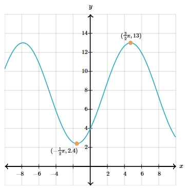
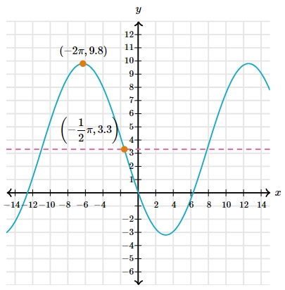

# AVP0009 — Single visual target

MathVerse:532 / MathVerse:542 · same type · Numeric representation and conversion

## Shared or similar visual information

The negative expression −(1/2)π in both images.

## Evidence locations

- Left image: The first component of the lower-left orange point's coordinate label (−(1/2)π,2.4).
- Right image: The first component of the orange point's coordinate label (−(1/2)π,3.3), near the vertical axis.

## Mathematical meanings

Left image: The marked point has x-coordinate −π/2. Right image: The marked point has x-coordinate −π/2.

## Same mathematical meanings

yes

## Rationales

The complete signed values match and both are x-coordinates; the different y-coordinates are outside the selected target.

Only the selected target is annotated. AI visual-review draft; not independently double-annotated by humans.
