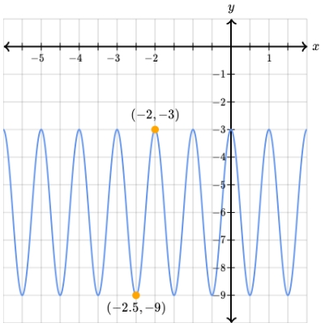
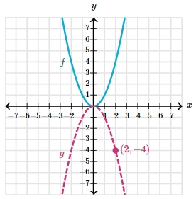

# AVP0010 — Single visual target

MathVerse:543 / MathVerse:571 · same type · Numeric representation and conversion

## Shared or similar visual information

X-coordinate notations differing only by a minus sign: −2 and 2.

## Evidence locations

- Left image: The first component, −2, of the upper orange point's coordinate label (−2,−3).
- Right image: The first component, 2, of the magenta point's coordinate label (2,−4).

## Mathematical meanings

Left image: The marked point has x-coordinate negative two. Right image: The marked point has x-coordinate positive two.

## Same mathematical meanings

no

## Rationales

The digit 2 is shared, but −2≠2; the x-coordinate values differ.

Only the selected target is annotated. AI visual-review draft; not independently double-annotated by humans.
