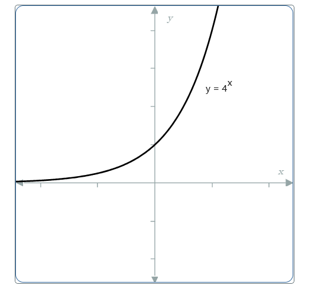
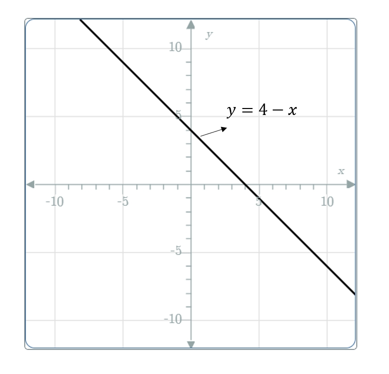

# AVP0011 — Single visual target

MathVerse:516 / MathVerse:626 · same type · Numeric representation and conversion

## Shared or similar visual information

The number 4 in both images.

## Evidence locations

- Left image: The 4 in the equation y=4^x beside the curve.
- Right image: The 4 in the equation y=4−x beside the straight line.

## Mathematical meanings

Left image: The exponential function has base 4. Right image: The linear function expression has constant term 4.

## Same mathematical meanings

no

## Rationales

The same number serves as an exponential base in one expression and an additive constant in the other.

Only the selected target is annotated. AI visual-review draft; not independently double-annotated by humans.
