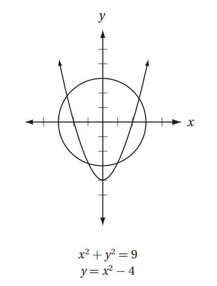
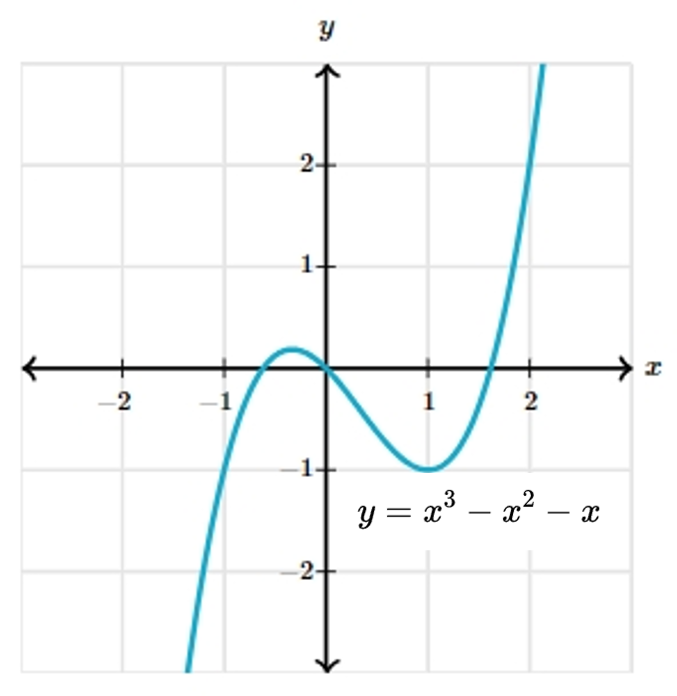

# AVP0012 — Single visual target

MathVista:137 / MathVerse:521 · same type · Numeric representation and conversion

## Shared or similar visual information

The exponent 2 on x in x².

## Evidence locations

- Left image: The exponent in f(x) = x².
- Right image: The exponent in the term −x² in the cubic formula.

## Mathematical meanings

Left image: The exponent squares x in the quadratic function. Right image: The exponent squares x in the negative quadratic term of the cubic function.

## Same mathematical meanings

yes

## Rationales

The exponent is 2 on the same base x in both formulas and denotes squaring.

Only the selected target is annotated. AI visual-review draft; not independently double-annotated by humans.
