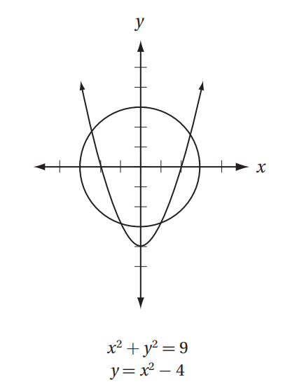
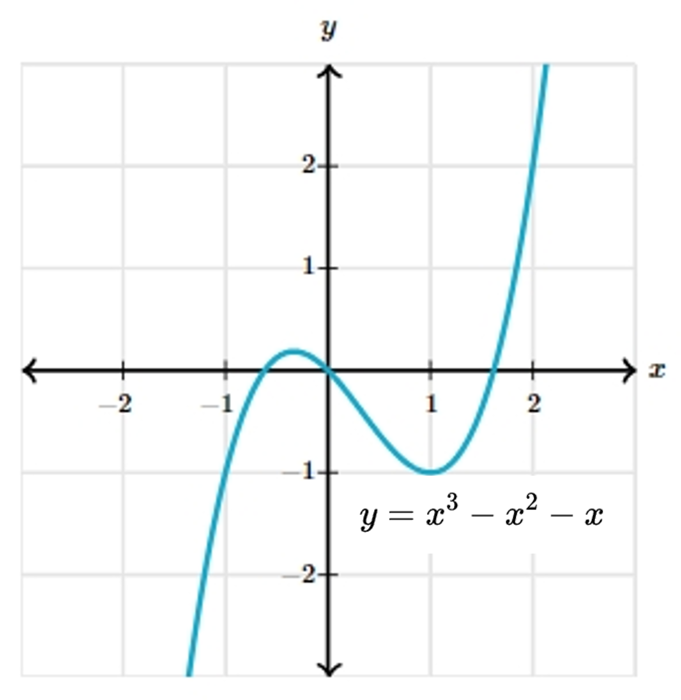

# AVP0012 — Single visual target

MathVerse:597 / MathVerse:521 · same type · Numeric representation and conversion

## Shared or similar visual information

The superscript 2 in x² in both images.

## Evidence locations

- Left image: The 2 above and to the right of x in y=x²−4, the second equation below the plot.
- Right image: The 2 in x² in the equation y=x³−x²−x below the curve.

## Mathematical meanings

Left image: This occurrence of x is raised to the second power, denoting squaring. Right image: This occurrence of x is raised to the second power, denoting squaring.

## Same mathematical meanings

yes

## Rationales

The selected 2 is the exponent of x in both expressions, with exponent value 2.

Only the selected target is annotated. AI visual-review draft; not independently double-annotated by humans.
