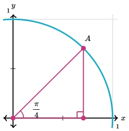
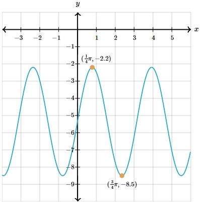

# AVP0013 — Single visual target

MathVerse:439 / MathVerse:530 · different type · Numeric representation and conversion

## Shared or similar visual information

Equivalent layouts for one real number: π/4 and (1/4)π.

## Evidence locations

- Left image: The angle label π/4 at the origin.
- Right image: The first component, (1/4)π, of the upper orange point's coordinate label ((1/4)π,−2.2).

## Mathematical meanings

Left image: The label gives the marked angle's measure in radians at the origin. Right image: The label gives the marked point's x-coordinate on the function graph.

## Same mathematical meanings

no

## Rationales

The expressions π/4 and (1/4)π have equal numerical values. The left expression represents an angle measure in radians. The right expression is the x-coordinate of the marked point.

Only the selected target is annotated. AI visual-review draft; not independently double-annotated by humans.
