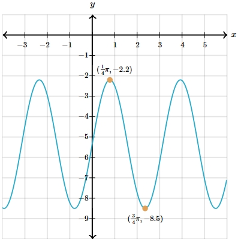

# AVP0013 — Single visual target

MathVerse:439 / MathVerse:530 · different type · Numeric representation and conversion

## Shared or similar visual information

Equivalent layouts for one real number: π/4 and (1/4)π.

## Evidence locations

- Left image: The angle label π/4 at the origin.
- Right image: The first component, (1/4)π, of the upper orange point's coordinate label ((1/4)π,−2.2).

## Mathematical meanings

Left image: The label gives the marked angle's measure in radians at the origin. Right image: The label gives the marked point's x-coordinate on the function graph.

## Same mathematical meanings

no

## Rationales

π/4=(1/4)π, but one is an angle measure and the other an x-coordinate; numerical equivalence does not establish the same local mathematical role.

Only the selected target is annotated. AI visual-review draft; not independently double-annotated by humans.
