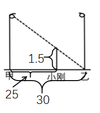
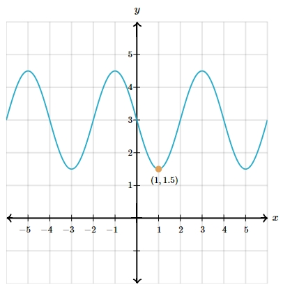

# AVP0014 — Single visual target

MathVerse:44 / MathVerse:541 · different type · Numeric representation and conversion

## Shared or similar visual information

The decimal 1.5 in both images.

## Evidence locations

- Left image: The label 1.5 beside the vertical height bracket next to the person in the center.
- Right image: The second component, 1.5, of the orange trough point's coordinate label (1,1.5).

## Mathematical meanings

Left image: The indicated vertical height beside the person has numerical value 1.5. Right image: The orange point has y-coordinate 1.5.

## Same mathematical meanings

no

## Rationales

The values match, but one labels a height and the other a coordinate component.

Only the selected target is annotated. AI visual-review draft; not independently double-annotated by humans.
