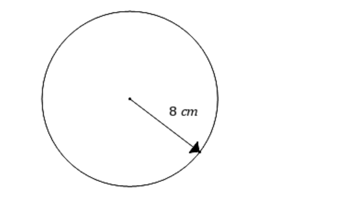
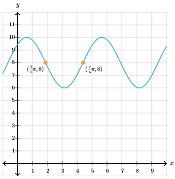

# AVP0015 — Single visual target

MathVerse:387 / MathVerse:538 · different type · Numeric representation and conversion

## Shared or similar visual information

The number 8 in both images.

## Evidence locations

- Left image: The 8 in the label 8 cm beside the radius arrow.
- Right image: The second component, 8, of the left orange point's coordinate label ((3/5)π,8).

## Mathematical meanings

Left image: The circle's radius has numerical length value 8, in cm. Right image: The left orange point has y-coordinate 8.

## Same mathematical meanings

no

## Rationales

A circle's radius length and a function point's y-coordinate have different local mathematical roles.

Only the selected target is annotated. AI visual-review draft; not independently double-annotated by humans.
