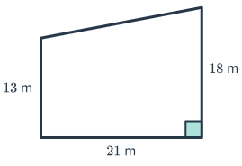
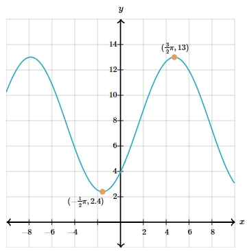

# AVP0016 — Single visual target

MathVerse:363 / MathVerse:532 · different type · Numeric representation and conversion

## Shared or similar visual information

The integer 13 in both images.

## Evidence locations

- Left image: The 13 in the label 13 m beside the quadrilateral's left vertical side.
- Right image: The second component, 13, of the upper orange point's coordinate label ((3/2)π,13).

## Mathematical meanings

Left image: The quadrilateral's left side has numerical length value 13, in m. Right image: The function point has y-coordinate 13.

## Same mathematical meanings

no

## Rationales

The integer values match, but one labels a side length and the other a y-coordinate.

Only the selected target is annotated. AI visual-review draft; not independently double-annotated by humans.
