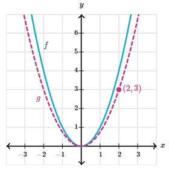

# AVP0017 — Single visual target

MathVerse:349 / MathVerse:570 · different type · Numeric representation and conversion

## Shared or similar visual information

The number 3 in both images.

## Evidence locations

- Left image: The 3 beside segment AC at the bottom of the image.
- Right image: The second component, 3, of the magenta point's coordinate label (2,3).

## Mathematical meanings

Left image: Segment AC has a length value of 3. Right image: The magenta point has y-coordinate 3.

## Same mathematical meanings

no

## Rationales

A length label and a y-coordinate label have different mathematical roles.

Only the selected target is annotated. AI visual-review draft; not independently double-annotated by humans.
