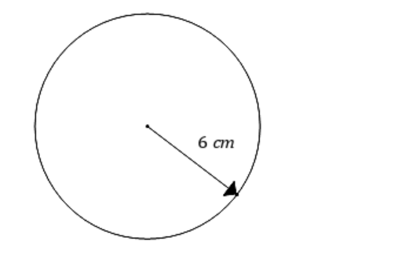
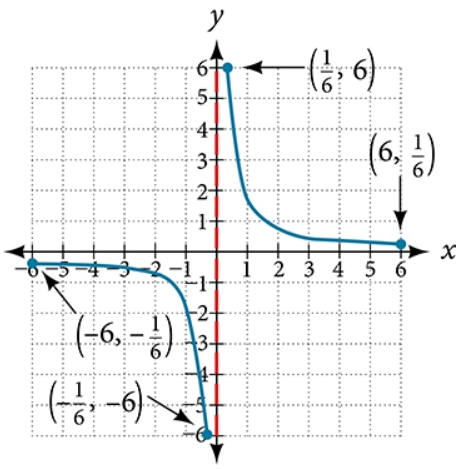

# AVP0018 — Single visual target

MathVerse:393 / MathVerse:486 · different type · Numeric representation and conversion

## Shared or similar visual information

The number 6 in both images.

## Evidence locations

- Left image: The 6 in the label 6 cm beside the circle's radius arrow.
- Right image: The second component, 6, of the upper blue point's coordinate label (1/6,6).

## Mathematical meanings

Left image: The number is the numerical part of the radius length 6 cm. Right image: The upper blue point has y-coordinate 6.

## Same mathematical meanings

no

## Rationales

The same numerical value is attached to a radius length in one image and a y-coordinate in the other.

Only the selected target is annotated. AI visual-review draft; not independently double-annotated by humans.
