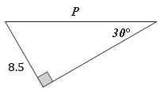
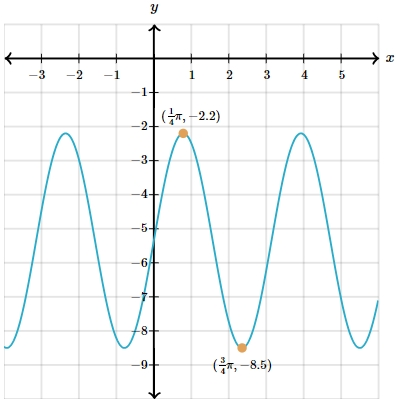

# AVP0019 — Single visual target

MathVerse:373 / MathVerse:530 · different type · Numeric representation and conversion

## Shared or similar visual information

Decimal notations differing only by a minus sign: 8.5 and −8.5.

## Evidence locations

- Left image: The label 8.5 beside the short side on the left of the triangle.
- Right image: The second component, −8.5, of the lower orange point's coordinate label ((3/4)π,−8.5).

## Mathematical meanings

Left image: The corresponding triangle side has positive length value 8.5. Right image: The function's trough point has negative y-coordinate −8.5.

## Same mathematical meanings

no

## Rationales

The minus sign changes the complete numerical value; a side length and a y-coordinate also serve different roles.

Only the selected target is annotated. AI visual-review draft; not independently double-annotated by humans.
