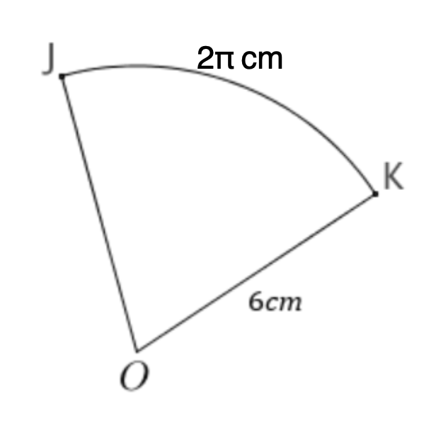
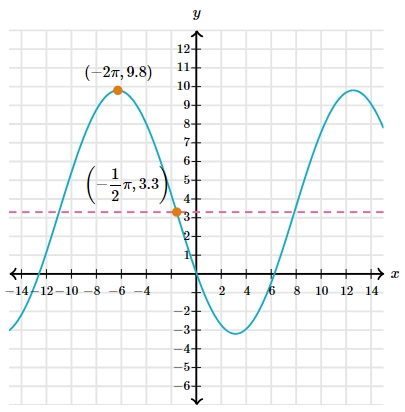

# AVP0020 — Single visual target

MathVerse:416 / MathVerse:542 · different type · Numeric representation and conversion

## Shared or similar visual information

Multiples of π differing only by a minus sign: 2π and −2π.

## Evidence locations

- Left image: The 2π in the label 2π cm above arc JK.
- Right image: The first component, −2π, of the upper-left peak point's coordinate label (−2π,9.8).

## Mathematical meanings

Left image: Arc JK has numerical arc-length value 2π, in cm. Right image: The peak point has x-coordinate −2π.

## Same mathematical meanings

no

## Rationales

2π and −2π differ in value; one labels an arc length and the other an x-coordinate. The π in the arc-length expression is not an angular unit.

Only the selected target is annotated. AI visual-review draft; not independently double-annotated by humans.
