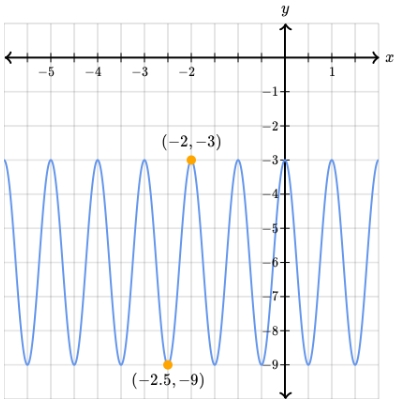

# AVP0021 — Single visual target

MathVerse:437 / MathVerse:543 · different type · Numeric representation and conversion

## Shared or similar visual information

The value −3 inside parentheses

## Evidence locations

- Left image: The second component, −3, of the lower hyperbola vertex's label (−1,−3).
- Right image: The second component, −3, of the upper orange point's label (−2,−3).

## Mathematical meanings

Left image: The marked hyperbola vertex has y-coordinate −3. Right image: The orange point on the oscillating curve has y-coordinate −3.

## Same mathematical meanings

yes

## Rationales

The complete signed values and their y-coordinate roles match; x-coordinates and object identities are outside the selected target.

Only the selected target is annotated. AI visual-review draft; not independently double-annotated by humans.
