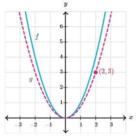

# AVP0022 — Single visual target

MathVerse:437 / MathVerse:570 · different type · Numeric representation and conversion

## Shared or similar visual information

The value 3 inside parentheses

## Evidence locations

- Left image: The second component, 3, of the upper hyperbola vertex's label (−1,3).
- Right image: The second component, 3, of the magenta point's label (2,3).

## Mathematical meanings

Left image: The marked hyperbola vertex has y-coordinate 3. Right image: The marked point on the parabola has y-coordinate 3.

## Same mathematical meanings

yes

## Rationales

Both selected values specify that a marked point has y-coordinate 3.

Only the selected target is annotated. AI visual-review draft; not independently double-annotated by humans.
