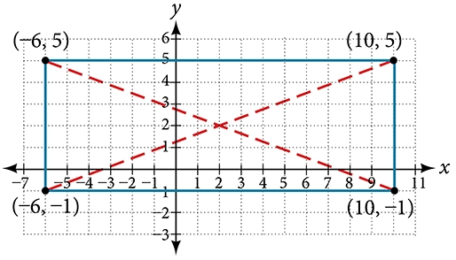
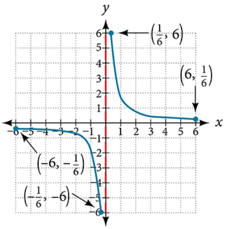

# AVP0023 — Single visual target

MathVerse:433 / MathVerse:486 · different type · Numeric representation and conversion

## Shared or similar visual information

The value −6 inside parentheses

## Evidence locations

- Left image: The first component, −6, of the rectangle's lower-left vertex label (−6,−1).
- Right image: The first component, −6, of the third-quadrant blue point's label (−6,−1/6).

## Mathematical meanings

Left image: The rectangle's lower-left vertex has x-coordinate −6. Right image: The blue point on the curve has x-coordinate −6.

## Same mathematical meanings

yes

## Rationales

Both selected values are x-coordinates equal to −6; the different y-coordinates do not affect this single-component target.

Only the selected target is annotated. AI visual-review draft; not independently double-annotated by humans.
