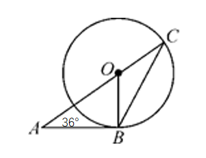
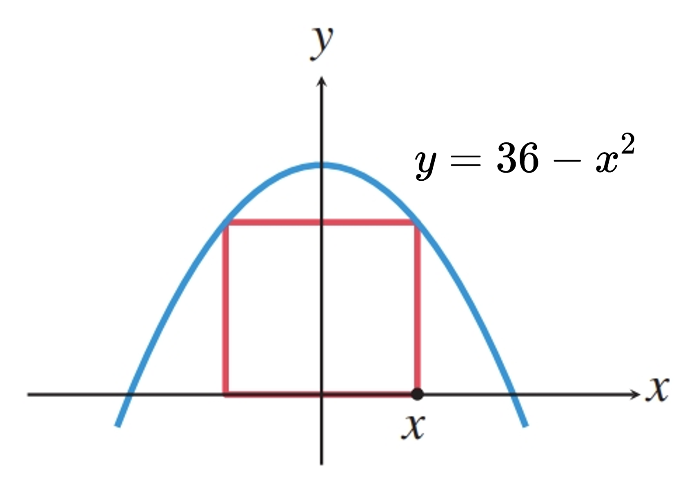

# AVP0024 — Single visual target

MathVerse:4 / MathVerse:600 · different type · Numeric representation and conversion

## Shared or similar visual information

The integer 36 in both images.

## Evidence locations

- Left image: The 36 in the angle label 36° at A in the lower-left part of the image.
- Right image: The 36 in the equation y=36−x² beside the parabola.

## Mathematical meanings

Left image: The marked angle measures 36 degrees. Right image: The quadratic function expression has constant term 36.

## Same mathematical meanings

no

## Rationales

The same integer specifies an angle's degree measure in one image and a function expression's constant term in the other.

Only the selected target is annotated. AI visual-review draft; not independently double-annotated by humans.
