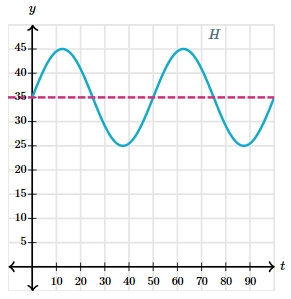

# AVP0025 — Single visual target

MathVerse:354 / MathVerse:548 · different type · Numeric representation and conversion

## Shared or similar visual information

The integer 35 in both images.

## Evidence locations

- Left image: The 35 beside the large triangle's right sloping side BD.
- Right image: The tick label 35 where the pink horizontal dashed line meets the vertical axis.

## Mathematical meanings

Left image: Segment BD has a length value of 35. Right image: The horizontal dashed line marks the y-coordinate level 35.

## Same mathematical meanings

no

## Rationales

One value labels a sloping side's length; the other marks a y-coordinate reference level.

Only the selected target is annotated. AI visual-review draft; not independently double-annotated by humans.
