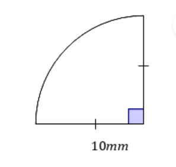
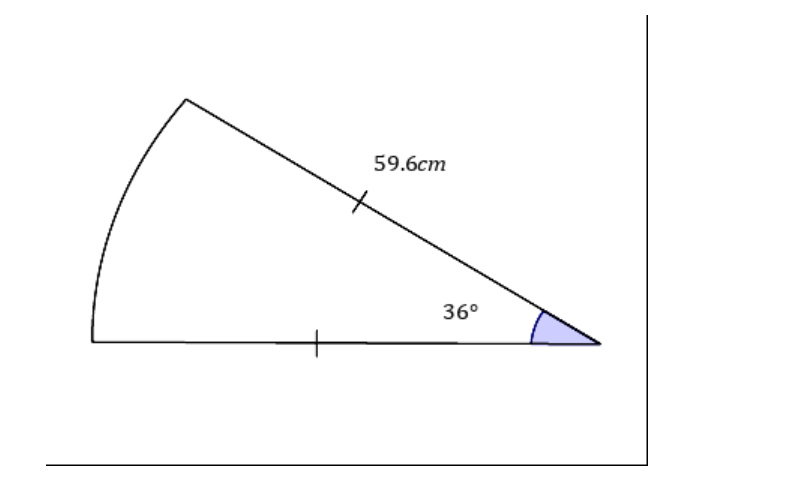

# AVP0027 — Single visual target

MathVerse:392 / MathVerse:405 · same type · Geometric markers

## Shared or similar visual information

A single short tick crossing a line segment

## Evidence locations

- Left image: A vertical tick crosses the middle of the lower horizontal radius; a matching single tick crosses the vertical radius on the right.
- Right image: A vertical tick crosses the middle of the lower horizontal radius; a matching single tick crosses the upper slanted radius.

## Mathematical meanings

Left image: The horizontal radius belongs to the equal-length group identified by single ticks and has the same length as the radius on the right. Right image: The horizontal radius belongs to the equal-length group identified by single ticks and has the same length as the slanted radius.

## Same mathematical meanings

yes

## Rationales

Repeated single ticks encode equal lengths in both images; this item compares the meaning of the ticks, rather than the specific lengths.

Only the selected target is annotated. AI visual-review draft; not independently double-annotated by humans.
