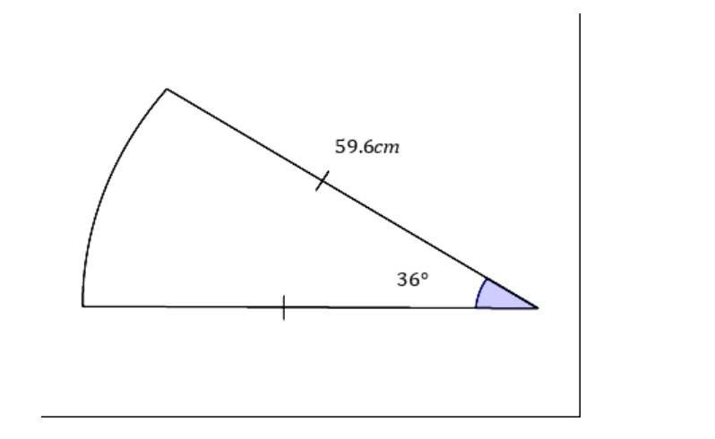

# AVP0028 — Single visual target

MathVerse:331 / MathVerse:405 · same type · Geometric markers

## Shared or similar visual information

A shaded angle wedge.

## Evidence locations

- Left image: The red wedge at A between the two rays.
- Right image: The purple wedge at the sector vertex.

## Mathematical meanings

Left image: The wedge marks the angle between the two rays at A, measuring 45°. Right image: The wedge marks the angle between the two radii of the sector, measuring 36°.

## Same mathematical meanings

yes

## Rationales

The colored wedge identifies which pair of rays bounds the labeled angle in each diagram.

Only the selected target is annotated. AI visual-review draft; not independently double-annotated by humans.
