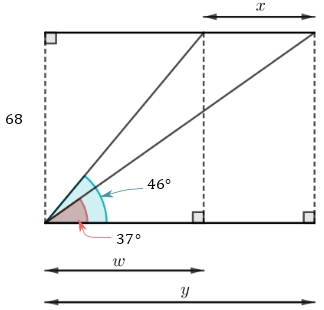
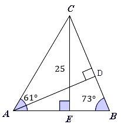

# AVP0029 — Single visual target

MathVerse:358 / MathVerse:360 · same type · Geometric markers

## Shared or similar visual information

A small square where a vertical line meets a horizontal base

## Evidence locations

- Left image: The lower end of the central vertical dashed line meets the black base; a small unfilled square sits above and to the left of the intersection.
- Right image: CE meets AB at its lower endpoint E; a small light-purple filled square sits above and to the left of E.

## Mathematical meanings

Left image: It marks the central vertical auxiliary line as perpendicular to the horizontal base. Right image: It marks CE as perpendicular to AB, with E as the foot of the perpendicular.

## Same mathematical meanings

yes

## Rationales

Both small squares directly mark the right angle formed where an auxiliary line meets the base.

Only the selected target is annotated. AI visual-review draft; not independently double-annotated by humans.
