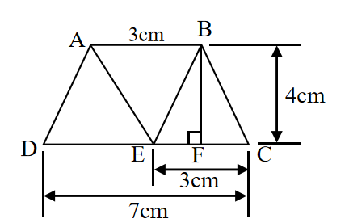
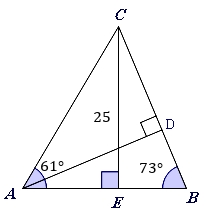

# AVP0029 — Single visual target

We-Math:1415 / MathVerse:360 · same type · Geometric markers

## Shared or similar visual information

A right-angle square where a vertical segment meets the horizontal base.

## Evidence locations

- Left image: The square at F between BF and the horizontal base.
- Right image: The square at E between CE and the horizontal base AB.

## Mathematical meanings

Left image: BF is perpendicular to the horizontal base at F. Right image: CE is perpendicular to AB at E.

## Same mathematical meanings

yes

## Rationales

Each square marks the vertical auxiliary segment as perpendicular to the base.

Only the selected target is annotated. AI visual-review draft; not independently double-annotated by humans.
