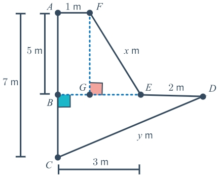

# AVP0030 — Single visual target

MathVerse:368 / MathVerse:349 · same type · Geometric markers

## Shared or similar visual information

A small filled square at the intersection of two lines

## Evidence locations

- Left image: A small pink square sits above and to the right of G, where the blue vertical broken line FG meets the blue horizontal broken line.
- Right image: A small light-purple square sits below and to the left of D in the upper right, where the dotted horizontal line BD meets the vertical line DC.

## Mathematical meanings

Left image: It indicates that FG is perpendicular to the horizontal line through G. Right image: It indicates that BD is perpendicular to DC.

## Same mathematical meanings

yes

## Rationales

The pink and purple filled squares are both right-angle markers; the different orientations of the attached broken lines do not change their meaning.

Only the selected target is annotated. AI visual-review draft; not independently double-annotated by humans.
