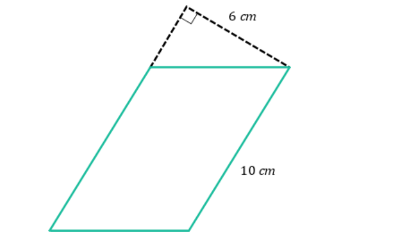
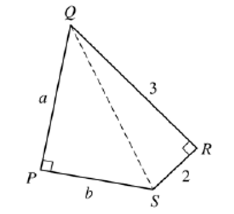

# AVP0031 — Single visual target

MathVerse:420 / MathVerse:756 · same type · Geometric markers

## Shared or similar visual information

An unfilled right-angle square rotated to follow two slanted lines

## Evidence locations

- Left image: Above the cyan quadrilateral, a tilted unfilled square sits at the vertex where two black dashed lines meet.
- Right image: At R on the right, a tilted unfilled square lies between the solid segments RQ and RS.

## Mathematical meanings

Left image: It indicates that the two upper dashed lines are perpendicular at their shared endpoint. Right image: It indicates that RQ is perpendicular to RS, forming a right angle at R.

## Same mathematical meanings

yes

## Rationales

Both tilted squares indicate right angles; the symbol may rotate with the sides to which it is attached.

Only the selected target is annotated. AI visual-review draft; not independently double-annotated by humans.
