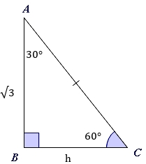
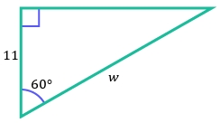

# AVP0032 — Single visual target

MathVerse:369 / MathVerse:371 · same type · Geometric markers

## Shared or similar visual information

A small square angle marker inside a triangle vertex

## Evidence locations

- Left image: At B in the lower left, a small light-purple filled square lies between the vertical side AB and the base BC.
- Right image: A small blue unfilled square lies inside the upper-left vertex of the green triangle.

## Mathematical meanings

Left image: It indicates that AB is perpendicular to BC, forming a right angle at B. Right image: It indicates that the left vertical side is perpendicular to the upper horizontal side, forming a right angle at the upper-left vertex.

## Same mathematical meanings

yes

## Rationales

Despite different fills and vertex locations, both squares explicitly mark a right angle in a triangle.

Only the selected target is annotated. AI visual-review draft; not independently double-annotated by humans.
