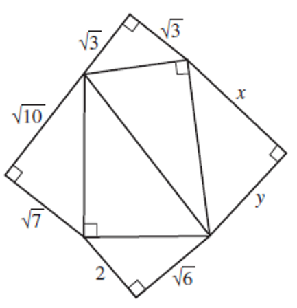
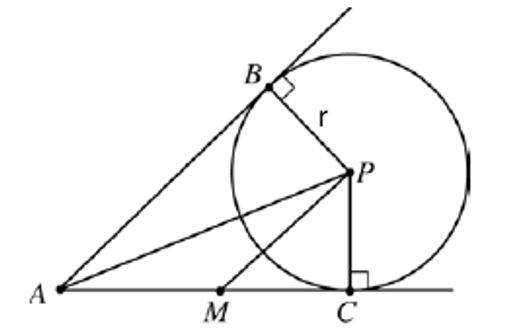

# AVP0033 — Single visual target

MathVerse:755 / MathVerse:760 · same type · Geometric markers

## Shared or similar visual information

A tilted unfilled square angle marker

## Evidence locations

- Left image: A tilted square sits inside the topmost vertex, between two slanted sides each labeled √3.
- Right image: A tilted square lies at B near the upper-left part of the circle, between the slanted straight line and the segment toward P.

## Mathematical meanings

Left image: It indicates that the two slanted sides at the topmost vertex are perpendicular. Right image: It indicates that the slanted straight line at B is perpendicular to the radius BP.

## Same mathematical meanings

yes

## Rationales

Both locations use the same type of right-angle square; its placement at a triangle vertex or near a circle does not change its meaning.

Only the selected target is annotated. AI visual-review draft; not independently double-annotated by humans.
