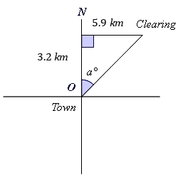
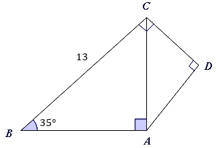

# AVP0034 — Single visual target

MathVerse:343 / MathVerse:357 · same type · Geometric markers

## Shared or similar visual information

A purple shaded acute-angle arc at a vertex

## Evidence locations

- Left image: A purple angle arc lies at O between the upward vertical direction and the slanted line extending toward the upper right, beside the annotation a°.
- Right image: A purple angle arc lies at B in the lower left between horizontal BA and BC extending toward the upper right, beside the annotation 35°.

## Mathematical meanings

Left image: The shaded angle arc identifies the angle being discussed between the two sides at O. Right image: The shaded angle arc identifies the angle being discussed between the two sides at B.

## Same mathematical meanings

yes

## Rationales

This item concerns the arc's function of identifying an angle, rather than the numerical value in the adjacent annotation; it does not assert equal angle values.

Only the selected target is annotated. AI visual-review draft; not independently double-annotated by humans.
