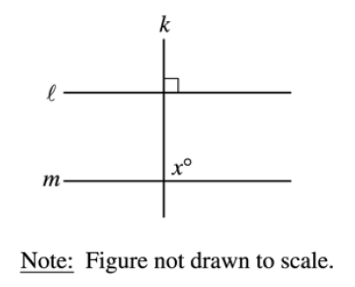
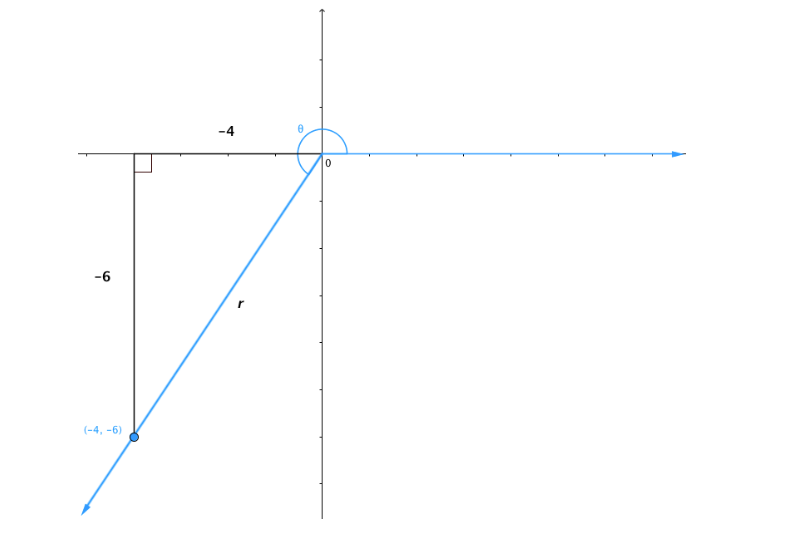

# AVP0035 — Single visual target

MathVerse:772 / MathVerse:458 · same type · Geometric markers

## Shared or similar visual information

A small square at the intersection of a horizontal and a vertical line

## Evidence locations

- Left image: A small unfilled square lies in the upper-right corner of the intersection of the upper horizontal line ℓ and the vertical line k.
- Right image: To the left of the origin, a small unfilled square lies in the lower-right corner where the downward vertical projection line meets the horizontal axis.

## Mathematical meanings

Left image: It indicates that k is perpendicular to ℓ. Right image: It indicates that the vertical projection line from the point to the horizontal axis is perpendicular to that axis.

## Same mathematical meanings

yes

## Rationales

Both squares explicitly mark a right angle between two lines, regardless of which side of the intersection contains the square.

Only the selected target is annotated. AI visual-review draft; not independently double-annotated by humans.
