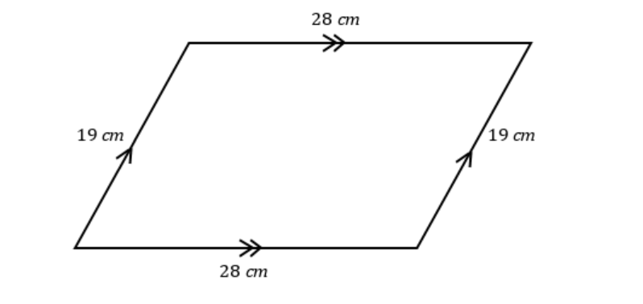
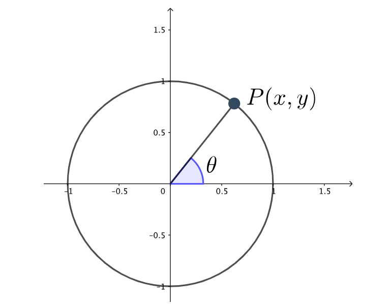

# AVP0036 — Single visual target

MathVerse:417 / MathVerse:449 · same type · Geometric markers

## Shared or similar visual information

An arrowhead attached to a line

## Evidence locations

- Left image: A single arrowhead points along the middle of the parallelogram's right slanted side toward the upper right, near the text 19 cm; the left side has a matching single arrowhead.
- Right image: An upward arrowhead sits at the top of the vertical coordinate axis, above the 1.5 tick.

## Mathematical meanings

Left image: It is a parallelism marker: the right slanted side belongs to the same parallel group as the left slanted side bearing the matching single arrowhead. Right image: It indicates the positive y direction and the direction in which the coordinate axis continues.

## Same mathematical meanings

no

## Rationales

Both images contain arrowheads on lines, but one marks a parallel relationship between sides and the other indicates a coordinate direction.

Only the selected target is annotated. AI visual-review draft; not independently double-annotated by humans.
