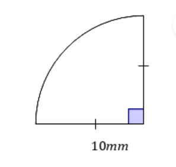
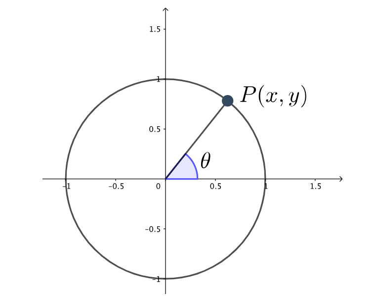

# AVP0037 — Single visual target

MathVerse:392 / MathVerse:449 · same type · Geometric markers

## Shared or similar visual information

A short vertical tick crossing a horizontal line

## Evidence locations

- Left image: A vertical tick crosses the middle of the sector's lower horizontal radius; the radius on the right bears a matching single tick.
- Right image: A short vertical tick marks the position labeled 0.5 on the positive x-axis.

## Mathematical meanings

Left image: It is an equal-length marker indicating that the lower radius has the same length as the radius on the right bearing the matching single tick. Right image: It is an axis tick marking the horizontal coordinate 0.5.

## Same mathematical meanings

no

## Rationales

The similar short ticks encode an equal-length relationship between segments and a coordinate reading position, respectively.

Only the selected target is annotated. AI visual-review draft; not independently double-annotated by humans.
