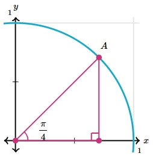

# AVP0038 — Single visual target

MathVerse:439 / MathVerse:493 · different type · Geometric markers

## Shared or similar visual information

A small square outline bounded by horizontal and vertical edges

## Evidence locations

- Left image: At the foot of the perpendicular below A, the magenta angle marker, horizontal axis, and vertical line enclose a small square.
- Right image: In the first quadrant, light-gray horizontal and vertical grid lines enclose a square cell between x=1 and 2 and y=1 and 2.

## Mathematical meanings

Left image: It is a right-angle symbol indicating that the perpendicular line is perpendicular to the horizontal axis. Right image: It is a coordinate-grid cell providing a reference for horizontal and vertical readings.

## Same mathematical meanings

no

## Rationales

Both images contain a definite square outline; one is an angle marker attached to the foot of a perpendicular, while the other is a background coordinate-grid cell.

Only the selected target is annotated. AI visual-review draft; not independently double-annotated by humans.
