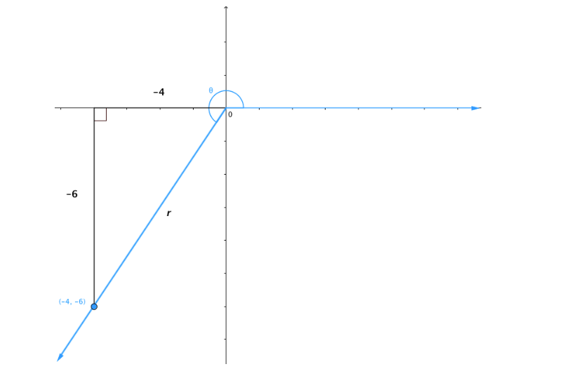
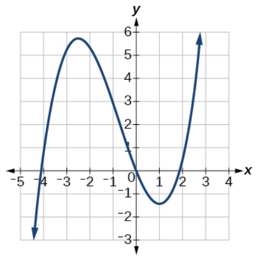

# AVP0039 — Single visual target

MathVerse:458 / MathVerse:488 · different type · Geometric markers

## Shared or similar visual information

A small unfilled square bounded by horizontal and vertical edges

## Evidence locations

- Left image: On the left side of the negative horizontal axis, a small unfilled right-angle square lies below and to the right of the top of the vertical projection line.
- Right image: In the first quadrant, a small light-gray grid cell lies between x=1 and 2 and y=1 and 2.

## Mathematical meanings

Left image: It indicates that the projection line forms a right angle with the horizontal axis. Right image: It represents a cell in the plotting coordinate grid, used for locating positions and reading values.

## Same mathematical meanings

no

## Rationales

The square outlines look similar, but a local right-angle marker and a background coordinate-grid cell serve different mathematical functions.

Only the selected target is annotated. AI visual-review draft; not independently double-annotated by humans.
