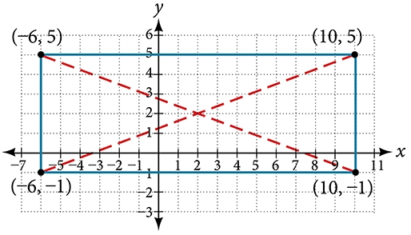
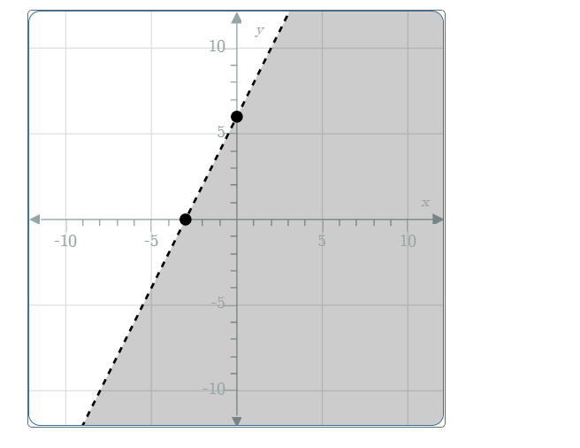

# AVP0040 — Single visual target

MathVerse:433 / MathVerse:511 · different type · Geometric markers

## Shared or similar visual information

Broken straight-line strokes extending diagonally

## Evidence locations

- Left image: A red dashed line inside the rectangle runs from the lower-left vertex (-6,-1) to the upper-right vertex (10,5).
- Right image: The left boundary of the gray region is a black dashed line extending from the lower left toward the upper right, with two filled points on it.

## Mathematical meanings

Left image: It is an auxiliary diagonal connecting a pair of opposite vertices of the rectangle. Right image: It is the boundary line of the gray solution region.

## Same mathematical meanings

no

## Rationales

The same diagonal dashed style represents an auxiliary connection inside a rectangle and a region boundary, respectively.

Only the selected target is annotated. AI visual-review draft; not independently double-annotated by humans.
