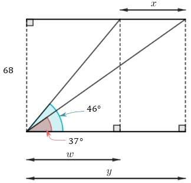
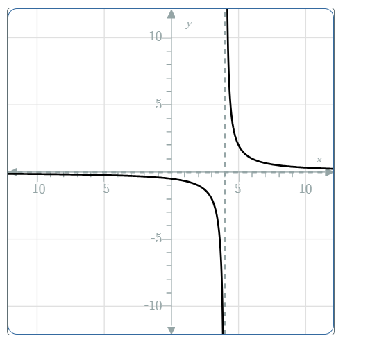

# AVP0041 — Single visual target

MathVerse:358 / MathVerse:582 · different type · Geometric markers

## Shared or similar visual information

Short dashed strokes arranged vertically

## Evidence locations

- Left image: A black vertical dashed line in the middle of the diagram runs from the upper endpoint of a slanted line to the lower horizontal edge.
- Right image: To the right of the y-axis, a gray vertical dashed line spans the top and bottom boundaries of the plotting area; the two black curve branches approach it from opposite sides.

## Mathematical meanings

Left image: It is an auxiliary perpendicular projection line connecting the upper endpoint to the horizontal base. Right image: It is a vertical asymptote of the function graph.

## Same mathematical meanings

no

## Rationales

Both images clearly use vertical dashed lines; a finite geometric projection line and a function asymptote have different mathematical roles.

Only the selected target is annotated. AI visual-review draft; not independently double-annotated by humans.
