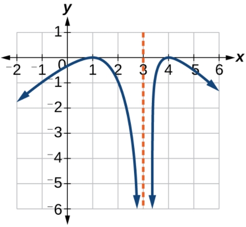

# AVP0042 — Single visual target

MathVerse:359 / MathVerse:489 · different type · Geometric markers

## Shared or similar visual information

A vertical dashed-line marker

## Evidence locations

- Left image: At the far right of the diagram, a black vertical dashed line runs from the upper horizontal dashed line to the foot on the base.
- Right image: Orange dashed strokes extend above and below the horizontal-axis tick 3; the dark-blue curve extends downward on both sides.

## Mathematical meanings

Left image: It is a vertical auxiliary side in the right-hand right-triangle construction, projecting the upper reference position onto the base. Right image: It is the vertical asymptote at x=3.

## Same mathematical meanings

no

## Rationales

The similar vertical broken lines belong to a finite geometric construction and the asymptotic structure of a function graph, respectively.

Only the selected target is annotated. AI visual-review draft; not independently double-annotated by humans.
