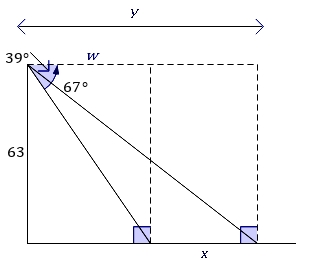
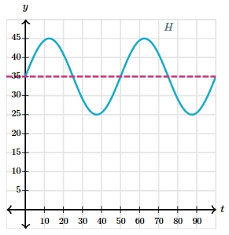

# AVP0043 — Single visual target

MathVerse:359 / MathVerse:548 · different type · Geometric markers

## Shared or similar visual information

An arrowhead at the right end of a horizontal line

## Evidence locations

- Left image: The uppermost horizontal double-ended dimension line labeled y has a right-pointing arrowhead at its far-right end.
- Right image: The bottom t-axis has a right-pointing arrowhead at its far-right end, to the right of the 90 tick.

## Mathematical meanings

Left image: It is an endpoint marker on a dimension line, defining the right boundary of the indicated length y. Right image: It indicates the positive t direction and the axis continuing to the right.

## Same mathematical meanings

no

## Rationales

Both sides contain right-pointing arrowheads, but one bounds a finite dimension and the other indicates a coordinate-axis direction.

Only the selected target is annotated. AI visual-review draft; not independently double-annotated by humans.
