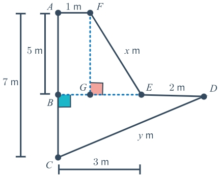

# AVP0044 — Single visual target

MathVerse:368 / MathVerse:535 · different type · Geometric markers

## Shared or similar visual information

A small square outline enclosed by horizontal and vertical lines

## Evidence locations

- Left image: A small pink square sits above and to the right of G, adjoining the blue vertical and horizontal broken lines.
- Right image: In the first quadrant, a small light-gray grid cell lies between x=4 and 5 and y=4 and 5.

## Mathematical meanings

Left image: It is a right-angle marker indicating that the vertical auxiliary line at G is perpendicular to the horizontal auxiliary line. Right image: It is a grid cell used for coordinate readings.

## Same mathematical meanings

no

## Rationales

The pink marker and gray grid cell both have square outlines; their mathematical functions are an explicit angle marker and a background reading reference, respectively.

Only the selected target is annotated. AI visual-review draft; not independently double-annotated by humans.
