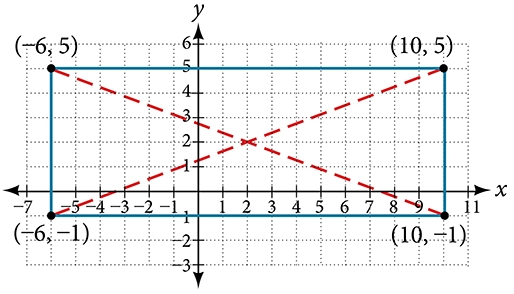
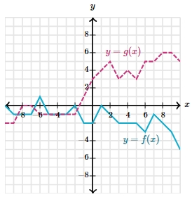

# AVP0045 — Single visual target

MathVerse:433 / MathVerse:557 · different type · Geometric markers

## Shared or similar visual information

A slanted connection drawn with broken strokes

## Evidence locations

- Left image: A red dashed line inside the rectangle runs from the upper-left vertex (-6,5) to the lower-right vertex (10,-1).
- Right image: The magenta polyline near the text y=g(x) is dashed, with each slanted segment drawn using broken strokes.

## Mathematical meanings

Left image: It represents an auxiliary diagonal of the rectangle. Right image: The dashed line itself forms the graph of function g, distinguishing it from the cyan solid graph of function f.

## Same mathematical meanings

no

## Rationales

The broken strokes look similar but belong to a geometric auxiliary line and the plotted function itself, respectively.

Only the selected target is annotated. AI visual-review draft; not independently double-annotated by humans.
