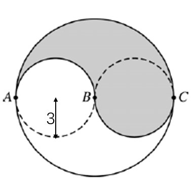

# AVP0046 — Single visual target

MathVerse:787 / MathVerse:568 · different type · Geometric markers

## Shared or similar visual information

Broken strokes following a curved path

## Evidence locations

- Left image: The lower semicircle of the inner circle on the left, running from A through the bottom to B, is drawn with black dashes.
- Right image: The upward-opening curve g on the left is drawn with magenta dashes, with its lowest point in the lower-left quadrant.

## Mathematical meanings

Left image: It represents a portion of an inner circle's circumference in the composite circular diagram. Right image: It represents the graph of function g, distinguishing it from the cyan solid graph of function f.

## Same mathematical meanings

no

## Rationales

Both sides contain curved dashed lines, but one belongs to a circular boundary and the other to a function graph.

Only the selected target is annotated. AI visual-review draft; not independently double-annotated by humans.
