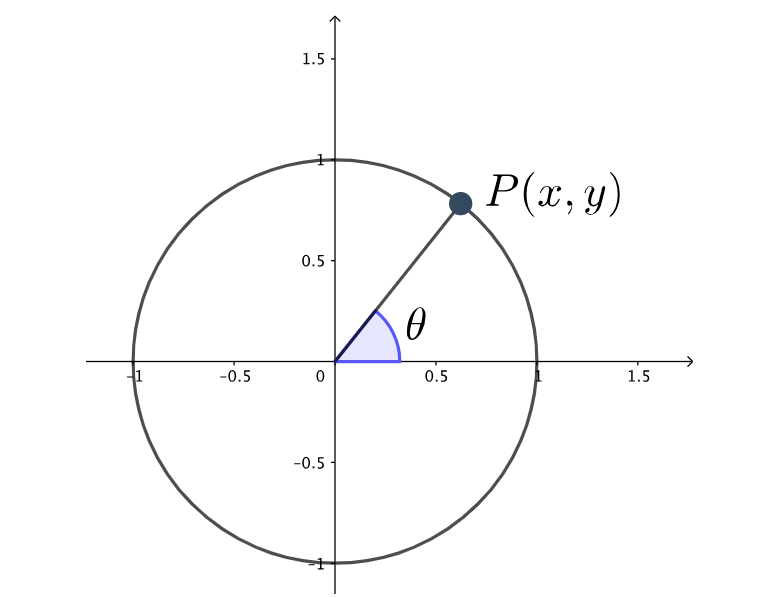

# AVP0047 — Single visual target

MathVerse:449 / MathVerse:544 · different type · Geometric markers

## Shared or similar visual information

A right-pointing arrowhead at the end of a horizontal line

## Evidence locations

- Left image: A right-pointing arrowhead sits at the far-right end of the positive x-axis, to the right of the 1.5 tick.
- Right image: A right-pointing arrowhead sits at the right end of the magenta horizontal double-ended arrow, at the top of the second peak.

## Mathematical meanings

Left image: It indicates the positive x direction and the coordinate axis continuing to the right. Right image: It is the right endpoint of a horizontal-distance marker, bounding the indicated span between two adjacent peaks.

## Same mathematical meanings

no

## Rationales

The arrowheads have similar directions and shapes; one indicates an axis direction and the other bounds the distance between peaks.

Only the selected target is annotated. AI visual-review draft; not independently double-annotated by humans.
