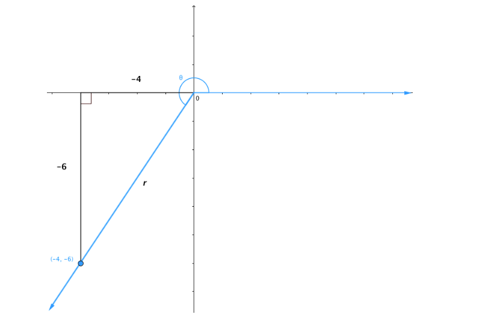

# AVP0048 — Single visual target

MathVerse:458 / MathVerse:546 · different type · Geometric markers

## Shared or similar visual information

A short tick crossing a horizontal coordinate axis

## Evidence locations

- Left image: The first thin vertical tick to the right of the origin lies on the blue positive horizontal axis.
- Right image: A vertical tick lies at the position labeled 1 on the horizontal t-axis.

## Mathematical meanings

Left image: It is a horizontal-coordinate tick marking a reading position on the axis. Right image: It is a tick for the horizontal coordinate t, marking a reading position on the axis.

## Same mathematical meanings

yes

## Rationales

Both short strokes serve as coordinate-axis ticks; this judgment does not require identical tick values or units.

Only the selected target is annotated. AI visual-review draft; not independently double-annotated by humans.
